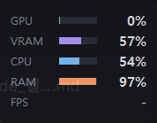

# Resource Monitor Overlay (자원 모니터)

A small always-on-top overlay for Windows + NVIDIA that shows **GPU · VRAM · CPU · RAM · FPS** at a glance,
plus a detail window that tells you *which program* is using them. Built for people who run local AI
(ComfyUI, Ollama, Stable Diffusion …) next to games and browsers on one GPU.

윈도우 + NVIDIA 그래픽카드용 작은 오버레이예요. GPU·VRAM·CPU·RAM·FPS를 한눈에 보여 주고,
더블클릭하면 **어떤 프로그램이** 얼마나 쓰는지 큰 창으로 보여 줘요. 로컬 AI(ComfyUI, Ollama 등)를 돌리면서
게임이나 브라우저를 같이 쓰는 사람에게 맞춰 만들었어요.

## 기능

| | |
|---|---|
| 오버레이 | GPU 사용률, VRAM, CPU, RAM은 퍼센트 막대로, FPS는 숫자로 보여 줘요. 92%를 넘으면 주황색이 돼요. |
| 조작 | 끌어서 옮기기(위치 기억), **더블클릭** = 큰 창, **오른쪽 클릭** = 메뉴(큰 창 / FPS 켜기·끄기 / 종료) |
| 큰 창 | 프로그램별로 **사용(바쁨) 막대**와 **VRAM·RAM 차지 막대**를 퍼센트와 함께 보여 줘요. 혼자 절반 넘게 차지하면 주황색. |
| 바로 끄기 | 줄마다 🗑 버튼. 한 번 누르면 "종료?"로 바뀌고, 3초 안에 한 번 더 누르면 그 프로그램을 바로 꺼요. 윈도우 시스템 프로그램에는 버튼이 없어요. |
| FPS | 앞에 띄운 창(게임·영상·브라우저)의 초당 프레임. Intel 공식 PresentMon을 써요. |
| 가벼움 | 윈도우 성능 카운터를 직접 읽어서 CPU를 1% 안팎만 써요. |
| 모니터 | 모니터 배치가 바뀌어 오버레이가 화면 밖으로 나가면 주 모니터 오른쪽 위로 돌아와요. 실행 중에 다시 켜면 큰 창이 떠요. |

## 설치 (컴퓨터 잘 몰라도 3번이면 끝)

1. **[여기를 눌러서 받기](https://github.com/echever-pixel/resource-monitor-overlay/releases/latest/download/ResourceMonitorOverlay.exe)**
   - 브라우저가 "흔히 다운로드되는 파일이 아닙니다"라고 하면 **⋯ → 계속(보관)**을 눌러요.
2. 받은 `ResourceMonitorOverlay.exe`를 **더블클릭**해요.
   - 파란 창 "Windows의 PC 보호"가 뜨면 **추가 정보 → 실행**을 눌러요.
     (돈 주고 사는 서명을 안 해서 뜨는 창이에요. 바이러스 아니에요.)
3. 화면 오른쪽 위에 작은 창이 뜨면 끝이에요. 🎉
   - 바탕화면에 두고 싶으면 exe를 바탕화면으로 옮기면 돼요.

### 방법 2: 파이썬으로 실행 (개발자용)
1. [Python 3.10+](https://www.python.org/downloads/) 설치 (설치할 때 "Add to PATH" 체크)
2. 이 저장소를 받아서 `run.bat` 더블클릭 (처음 한 번 `psutil`을 설치해요)

## FPS 켜기 (딸깍 한 번)

FPS는 윈도우의 화면 기록을 읽어야 해서, **처음 한 번만** 허락이 필요해요. 앱이 알아서 물어봐요.

1. 처음 켜면 **"FPS를 보려면 허락이 한 번 필요해요"** 창이 저절로 떠요.
2. **[항상 켜기 (추천)]** 클릭
3. 파란 확인 창(사용자 계정 컨트롤)이 뜨면 **[예]** 클릭
4. **PC를 한 번 다시 시작**하면 끝. 그다음부터는 켤 때마다 FPS가 저절로 나와요.

- 다시 시작하기 싫으면 **[이번만 켜기]** → [예]: 지금부터 1시간 동안만 재요.
- 창을 닫았거나 [나중에]를 눌렀으면: 오른쪽 위 작은 창에 **마우스 오른쪽 클릭 → "FPS 켜기 (권한 허락)"**.
- FPS 칸에 뜨는 말: `받는중` = 측정 도구 받는 중(처음 한 번, 1MB) · `권한` = 위 허락 필요 · `-` = 앞에 띄운 창이 지금 화면을 안 그림

어떤 일을 하냐면:
- 측정 도구는 Intel 공식 PresentMon(0.93MB)이에요. [공식 GitHub 릴리스](https://github.com/GameTechDev/PresentMon/releases)에서 받고,
  파일 지문(SHA-256)이 맞을 때만 써요.
- [항상 켜기]는 지금 윈도우 계정을 윈도우 기본 그룹 **"Performance Log Users"**(성능 기록을 읽을 수 있는 그룹)에 넣어요.
  관리자 권한을 주는 게 아니에요. 되돌리려면 관리자 PowerShell에서
  `Remove-LocalGroupMember -SID S-1-5-32-559 -Member $env:USERNAME`

## 요구 사항

- Windows 10 / 11
- NVIDIA 그래픽카드 (`nvidia-smi` 사용). 다른 그래픽카드는 GPU 줄이 비어 있을 수 있어요.

## 데이터 위치

설정·기록은 `%LOCALAPPDATA%\ResourceMonitorOverlay`에만 저장해요(오버레이 위치, PresentMon, 오류 기록).
인터넷에는 PresentMon을 처음 받을 때만 접속해요.

## 라이선스

MIT. PresentMon은 Intel의 MIT 라이선스 프로그램이며, 이 저장소에는 포함하지 않고 공식 릴리스에서 받아요.
